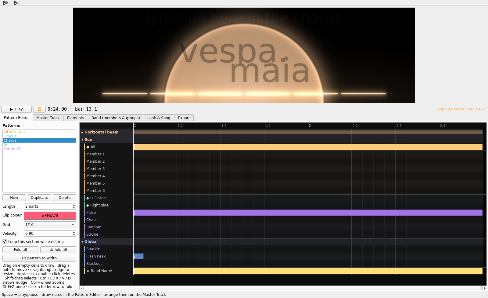

# LED Wall Creator

A free desktop editor (Windows, macOS, Linux) for programming LED wall backgrounds for live shows,
the way you program drums in a DAW. You build the visual elements of a song (a sunset sun, a horizontal beam, a hexagon,
vertical bars...), draw *when* each one lights up in a pattern editor, arrange those patterns over
the song's waveform, and render the result to an `.mp4` for the LED wall (3840×1080 by default).

**[⬇ Download for Windows, macOS or Linux](#install)**



## How to use the editor

The window has a live **preview** on top (Space = play / pause, Home = back to the start) and six
tabs below. A typical song goes through them in this order:

1. **Look & Song: load the song.** *Load Audio File…* analyses the track and detects the BPM and
   where bar 1 starts. Fix them by hand if needed (½ / ×2 for half or double tempo, *Auto* to go
   back to the detected values). Pick **one colour for the song**: every element and every member
   share it. The *Pastel* swatches suit a soft, sunset look. The same tab holds the global light
   settings (glow, attack / release, audio reactivity, strobe rate, and the **ambient glow**: the soft
   wash of the song colour rising from the bottom of the wall, with its intensity (0 = off) and how much
   it pulses with the music) and the lyrics settings
   (room at the top, size, font).

2. **Band: members and groups.** List the members from left to right as they stand on stage, and
   make groups (e.g. *Left side*, *Rhythm section*). Every member and every group gets a lane inside
   every element in the pattern editor.

3. **Elements: build what is on the wall.** *Add* a preset: **Sunset sun**, **Horizontal beam**,
   **Hexagon / Polygon**, **Ring**, **Single bar**, **Vertical blocks**, **Light shafts** or
   **Horizon lights**, or build your own: a **Custom** element is made of shapes you combine
   (lines, dashed lines, rectangles, circles, arcs, polygons, rays). Each shape has its own size,
   position, angle, thickness and fill. Click a shape in the preview to pick it, drag it to move it
   and use the wheel to resize it. Each type shows only its own settings, e.g. a hexagon's radius and sides,
   the number of bars, or a beam's segments and parallel lines. While you're in this tab the
   preview shows only the element you're editing, pulsing on the beat so you can see the effect
   (untick *Preview* to see the song at the playhead instead). Drag it in the preview to move it
   and use the mouse wheel to resize it. The top of the list is the front layer.

   Elements are shared by the whole song (an element looks the same everywhere it is used), and
   **each pattern chooses which ones it uses**: pick the pattern at the top of the list and tick
   its elements. The intro could be just the sun, and the chorus the sun plus a beam. A new
   pattern starts with the same elements as the one you were on, and *Add* puts a new element in
   the selected pattern only.

   **★ Band name**, at the top of the list, holds the band name layer: the text, the **font**
   (eight fonts ship with the app so they look the same on every computer, and any installed font
   works too), the layout (one line, two centred lines, or stacked with the second line shifted
   right), letter case, colour (*Dark cut-out* turns it into a silhouette cut into whatever is
   behind it), size and position (or drag it and use the wheel in the preview).

   *When it shows*: tick **Always on for the whole song** to keep the name lit from start to end
   with no fades. Otherwise it shows wherever the Global → *Band Name* lane has notes, with its own
   fade-in and fade-out. To make it glow, put notes on the Global → **Band Name Light** lane: the
   name glows while the note lasts and flashes when it starts (a short note = a quick flash, a long
   one = a held glow). Its glow strength, fades, flash and radius are set in *Band Name Light*.

   Every element is made of **parts** (a hexagon's sides, the bars, a beam's segments), shared
   out between the members in order. With 6 members and a 6-segment beam, each member has one
   segment. A 1-segment beam or a single bar lights up when anyone in it plays.

4. **Pattern Editor: draw the light.** A pattern is a loop of 1–16 bars on a 1/16 grid. Every
   element the pattern uses is a folder of lanes:
   - **All**: the whole element
   - **one lane per member** and **one per group**: their parts of that element
   - **Pulse / Chase / Random / Strobe**: motion on that element

   An element is only on the wall while one of its lanes plays, so notes are how you bring
   elements **in and out of the scene**. The **Global** folder holds Sparkle, Flash Peak (an
   accent-coloured burst on whatever is in the scene), Blackout, Band Name (shows the name) and
   Band Name Light (makes it glow).

   Note length = how long it's lit, note velocity = how bright (the *Velocity* box sets new notes
   and edits the selected ones). While you edit, playback **loops the section** of the master
   track you're working on.

   | Action | How |
   |---|---|
   | Draw a note | drag on an empty cell |
   | Move / resize | drag the note / drag its right edge |
   | Delete | right-click or double-click |
   | Select several | Shift-drag, Ctrl+A |
   | Copy / cut / paste / duplicate | Ctrl+C / X / V / D |
   | Nudge | arrow keys |
   | Zoom | Ctrl+wheel |
   | Fold a folder | click its row |
   | Move the playhead | click or drag the ruler (bar numbers) |

5. **Master Track: arrange the song.** First line the audio up with the grid. **Drag the
   waveform** left or right (it moves freely, not bar by bar) until the song's first downbeat sits
   on bar 1. The bar at the bottom of the tab shows the **BPM** (type it, use ½ / ×2, or **Tap**
   along) and where **bar 1** falls in the audio (with ◀ ▶ nudges of 5 ms and 50 ms).
   *Auto-detect* goes back to what the analysis found. Clips stay on their bars when you change
   the tempo or move the audio. Then place patterns as clips on three tracks over the
   waveform: double-click a track (or *Place pattern at playhead*). Drag a clip to move it
   (Ctrl-drag copies). Drag its right edge to stretch it: the pattern repeats. **Double-click a
   clip to open its pattern in the Pattern Editor at the spot you clicked.** Right-click for
   duplicate, delete, *make unique* (its own copy of the pattern) and *reset length*. The
   **Lyrics** lane puts text in the band reserved at the top of the wall (double-click it to add a
   line). Shift-drag the ruler to set a **loop region**, and tick *Seamless loop* for a background
   that loops without a visible jump.

6. **Export: watch it, then render the video.** *Watch it* plays the whole video from the start
   (with a position slider to scrub), and the preview gets most of the window. **View** switches
   between the plain wall and a **stage simulation**: your wall behind the band, one silhouette per
   member in Band order, with the audience in front. **On stage: LED wall** lights the band from
   behind (backlit silhouettes, light spilling into the haze and onto the floor). **On stage:
   projector** sends the light from the front: the picture lands on the band and they cast shadows
   on the screen. *Open big preview window* shows the same view in its own window: F11 or a
   double-click for fullscreen, Space to play / pause, Esc to close.

   To render, choose 3840×1080, 1920×1080 or a custom size, and 30 or 60 fps.
   The video covers the loop region if there is one, otherwise the whole song. With ffmpeg
   installed you get a high-bitrate H.264 file and can include the song's audio.

Save the project with **File → Save Project** (`.json`). Undo / redo is Ctrl+Z / Ctrl+Shift+Z.

## Install

### Option 1: download the app (no Python needed)

Go to the **[Releases page](https://github.com/HenriqueSim/LED_WALL_CREATOR/releases/latest)**
and download the file for your computer:

| Computer | File | How to start it |
|---|---|---|
| **Windows** 10 / 11 | `LEDWallCreator-windows.zip` | Unzip it (right-click → *Extract All*), open the folder and double-click **LEDWallCreator.exe**. If Windows shows *"Windows protected your PC"*, click **More info → Run anyway** (the app isn't signed with a paid certificate). |
| **macOS** (Apple Silicon: M1 and newer) | `LEDWallCreator-macos.zip` | Unzip it and drag **LEDWallCreator** to *Applications*. The first time, **right-click it → Open → Open** (the app isn't notarised by Apple). If macOS says it is "damaged", run `xattr -cr /Applications/LEDWallCreator.app` in Terminal once. |
| **Linux** (x86-64) | `LEDWallCreator-linux.tar.gz` | `tar -xzf LEDWallCreator-linux.tar.gz` and run `./LEDWallCreator/LEDWallCreator`. |

Everything is included, ffmpeg too. Keep the files inside the unzipped folder together. The
download is big (a few hundred MB) because it carries its own copies of Python, Qt, OpenCV and
the audio analysis libraries.

### Option 2: run it from the source (any computer with Python)

1. Install **Python 3.10 or newer** from [python.org](https://www.python.org/downloads/).
   On Windows, tick **"Add python.exe to PATH"** in the installer.
2. Get the code: click **Code → Download ZIP** on this page and unzip it, or
   `git clone https://github.com/HenriqueSim/LED_WALL_CREATOR.git`.
3. Start it:
   - **Windows:** double-click **`run_windows.bat`**
   - **macOS / Linux:** run **`./run_mac_linux.sh`** in a terminal (on macOS you can also
     right-click it → Open With → Terminal)

The first start takes a few minutes while it sets up a private Python environment inside the
folder and downloads the libraries. After that it starts in seconds. To update, download the new
code and run the script again.

Doing it by hand instead:

```bash
cd python
python3 -m venv .venv
source .venv/bin/activate          # Windows: .venv\Scripts\activate
pip install -r requirements.txt
python led_wall_motion_generator.py            # or: ... my_song.json / ... my_song.wav
```

### Making a release (maintainers)

The builds are made by GitHub Actions (`.github/workflows/build.yml`). Push a version tag and,
about 15 minutes later, the Windows, macOS and Linux downloads appear on the Releases page. Each
build is self-tested first (it opens the window, analyses audio, renders and exports a short
video):

```bash
git tag v1.0.0
git push origin v1.0.0
```

To build one locally: `pip install pyinstaller`, then `pyinstaller LEDWallCreator.spec` inside
`python/`. The app ends up in `python/dist/`. Run it with `--selftest` to check it.

## Code layout

```
python/
  led_wall_motion_generator.py   launcher (fonts, theme, main window, --selftest)
  LEDWallCreator.spec            PyInstaller recipe for the standalone app
  requirements.txt
  fonts/                         bundled fonts (SIL Open Font License)
  ledwall/
    model.py       song data: members, groups, elements, patterns, clips, lyrics, look
    audio.py       audio decoding + librosa analysis (BPM, beats, energy) in a thread
    engine.py      time -> frame state: evaluates clips / notes, envelopes, per-element levels
    renderer.py    frame state -> image: element drawing, bloom, band name, lyrics (OpenCV)
    stage.py       stage simulation (band, audience, LED wall / projector lighting)
    resources.py   bundled files (fonts) for source and packaged runs
    export.py      video export thread (OpenCV VideoWriter / ffmpeg)
    controller.py  undo / redo and change notifications
    gui/           one module per tab + the main window
docs/reference/    design references (logo layout, vertical blocks)
```
